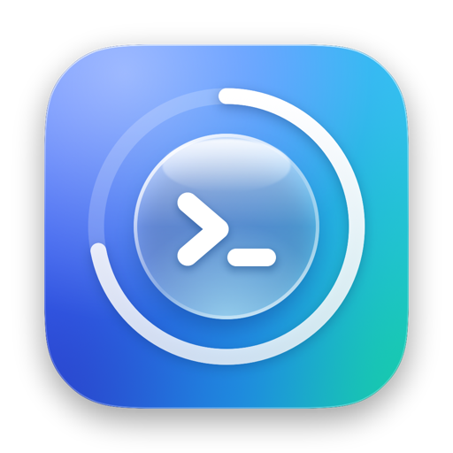
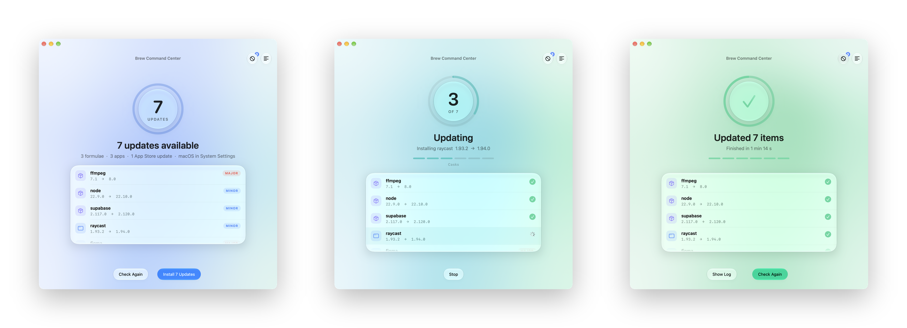
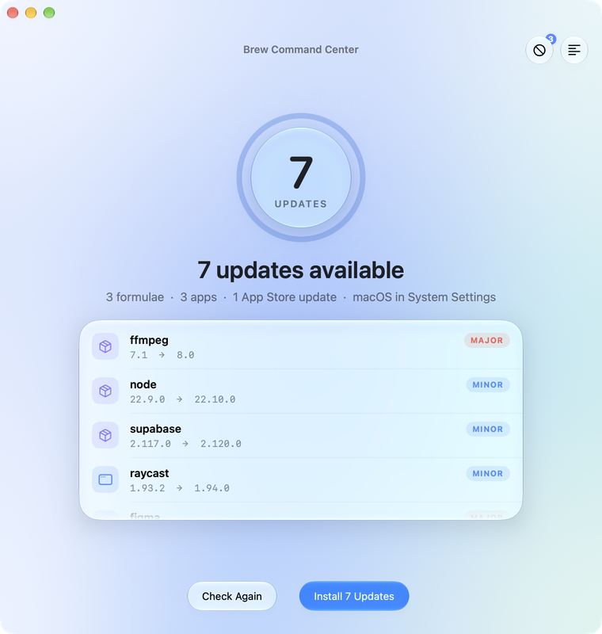
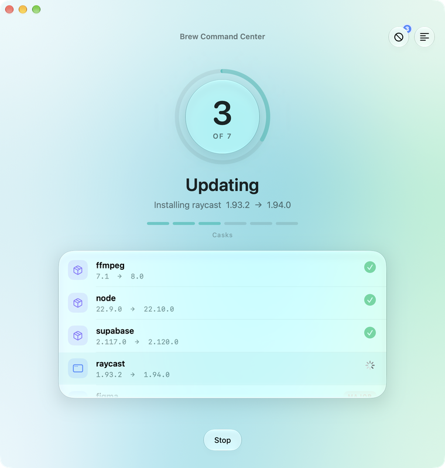
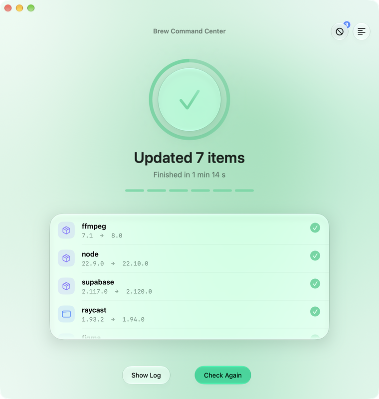
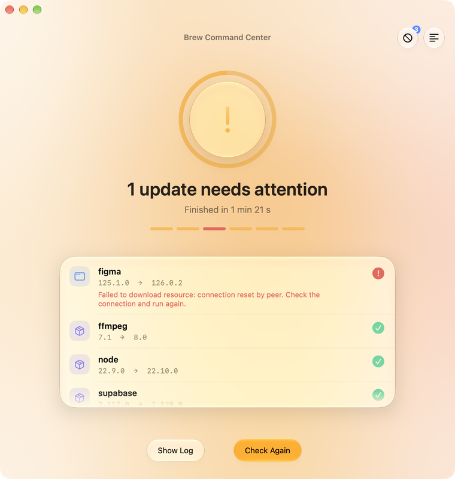
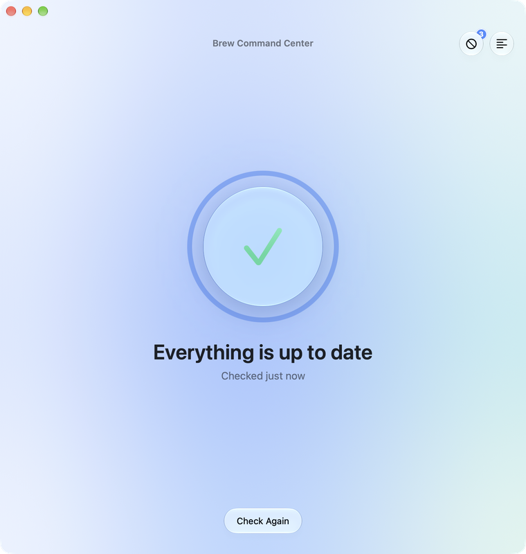
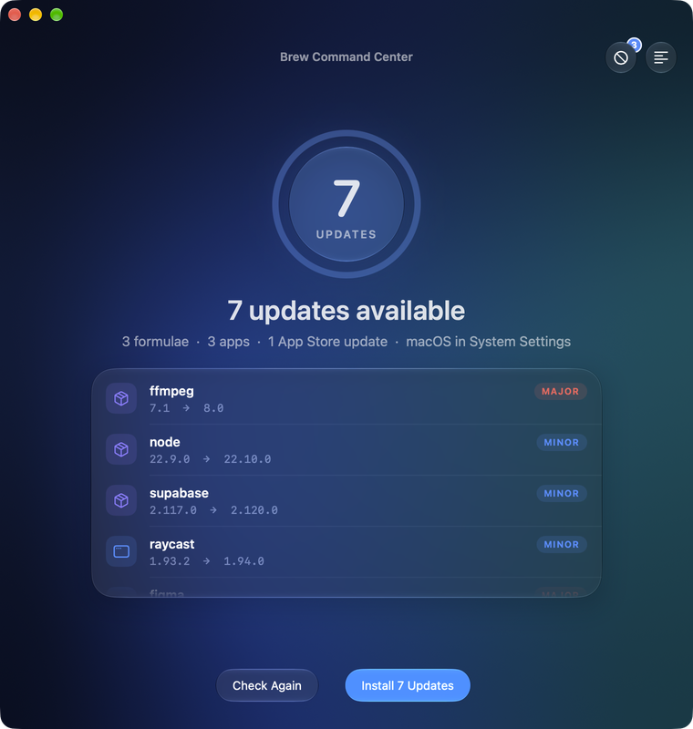
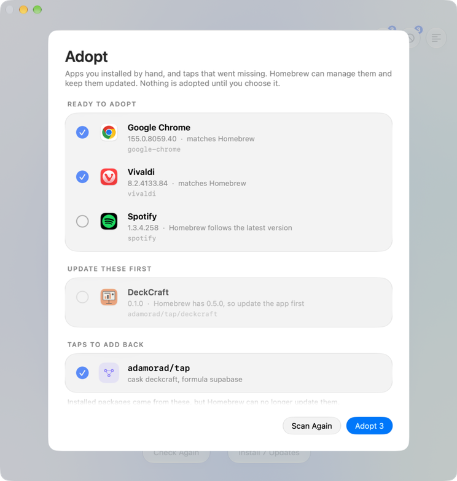
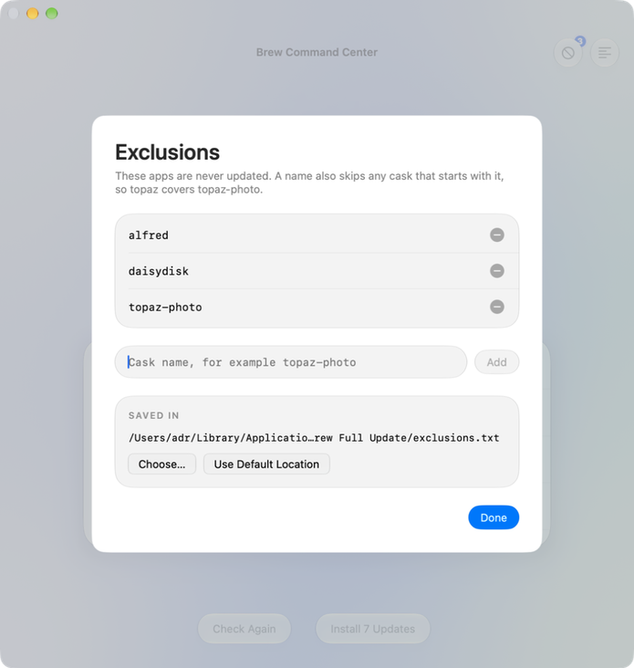

<div align="center">



# Brew Full Update

**One calm window for every update on your Mac.**<br>
Homebrew, apps, the App Store, developer tools and cleanup: checked first, installed when you say so.

<br>

[](https://github.com/AlbiDR/Brew-Full-Update/releases/latest)
[](#install)
[](#command-line)

[Install](#install) · [Using the app](#using-the-app) · [What gets updated](#what-gets-updated) · [Exclusions](#exclusions) · [Command line](#command-line) · [Development](#development)

<br>

<picture>
  <source media="(prefers-color-scheme: dark)" srcset="assets/screenshots/hero-dark.png">
  
</picture>

</div>

<br>

## Why it feels different

<table>
  <tr>
    <td width="33%" valign="top">
      <h4>Check first</h4>
      The app looks for updates when it opens and shows exactly what would change: every package, its version jump, and whether it is a major, minor or patch release.
    </td>
    <td width="33%" valign="top">
      <h4>See everything</h4>
      Each update is a row that fills in as it installs. Anything that fails goes to the top with Homebrew's own reason, so a problem is never buried in scrollback.
    </td>
    <td width="33%" valign="top">
      <h4>Stay in control</h4>
      Nothing installs until you press <b>Install</b>. Apps you exclude are left alone, running apps are skipped, and macOS updates are only reported.
    </td>
  </tr>
</table>

<br>

## A closer look

<table>
  <tr>
    <td align="center" width="50%">
      <br>
      <sub><b>Ready</b> · the count, the breakdown and each update's version jump</sub>
    </td>
    <td align="center" width="50%">
      <br>
      <sub><b>Updating</b> · progress follows the items, and the live row stays in view</sub>
    </td>
  </tr>
  <tr>
    <td align="center">
      <br>
      <sub><b>Done</b> · what was installed and how long it took</sub>
    </td>
    <td align="center">
      <br>
      <sub><b>Needs attention</b> · failures rise to the top, with the reason</sub>
    </td>
  </tr>
  <tr>
    <td align="center">
      <br>
      <sub><b>Up to date</b> · a quiet confirmation</sub>
    </td>
    <td align="center">
      <br>
      <sub><b>Dark mode</b> · the colour mood follows the system</sub>
    </td>
  </tr>
</table>

<br>

## Install

You need **macOS 27 or later** and [Homebrew](https://brew.sh). [`mas`](https://github.com/mas-cli/mas) and the `*env` tools are optional; whatever isn't installed is skipped.

### The app

1. Download the zip from the [latest release](https://github.com/AlbiDR/Brew-Full-Update/releases/latest) and unzip it.
2. Move **Brew Full Update.app** to Applications.
3. The app isn't notarized, so macOS blocks the first launch. Right-click it, choose **Open**, and confirm. Or run this once:

```bash
xattr -dr com.apple.quarantine "/Applications/Brew Full Update.app"
```

### The command line

```zsh
git clone https://github.com/AlbiDR/Brew-Full-Update.git ~/Brew-Full-Update
```

Then add these two lines to `~/.zshrc`:

```zsh
source ~/Brew-Full-Update/brew_full_update.zsh
alias brew-full-update='brew_full_update'
```

<br>

## Using the app

Open it and it checks. When the check finishes you see the updates waiting, and one button decides what happens next.

| Button | What it does |
|---|---|
| **Install N Updates** | Installs everything in the list. |
| **Check Again** | Looks again, without installing anything. |
| **Stop** | Stops a check or an update. The script cleans up after itself. |
| **Adopt** (top right) | Bring hand-installed apps and missing taps under Homebrew. A badge shows how many apps are ready. |
| **Exclusions** (top right) | Choose apps to leave out of updates. |
| **Log** (top right) | The raw log, with Copy and Open Log File. |

The window changes colour with what it is doing: blue while it is calm, teal while updating, green when everything worked, amber when something needs you.

Admin rights are asked for only when app updates are waiting, through a native password prompt, and never during a check.

**Keyboard shortcuts**

| Shortcut | Action |
|---|---|
| `⌘U` | Install updates |
| `⌘R` | Check again |
| `⌘.` | Stop |
| `⇧⌘A` | Adopt apps and taps |
| `⇧⌘E` | Exclusions |
| `⌥⌘L` | Log |

<br>

## What gets updated

| | Step | What happens |
|---|---|---|
| 1 | **Diagnostics** | Checks the network, runs `brew update`, lists what is outdated, flags missing or deprecated packages, and shows `brew doctor` warnings for information only. |
| 2 | **Formulae** | Upgrades one by one. A failed upgrade is retried once. |
| 3 | **Casks** | The same for apps. Excluded casks and apps that are running are skipped. |
| 4 | **App Store** | `mas upgrade` when `mas` is installed. Pending macOS updates are listed but never installed: those can restart the Mac, so they stay in System Settings. |
| 5 | **Dev runtimes** | `nodenv`, `pyenv` and `rbenv` sync. Then `npm -g`, `pipx`, `uv tool` and `rustup`, each only when installed. Then Oh My Zsh and its plugins and themes, with `git pull --ff-only` so local edits are never overwritten. |
| 6 | **Cleanup** | `brew autoremove` and `brew cleanup --prune=7`, then the Homebrew cache size and the free disk space gained. |

Before the first upgrade, the versions you have installed are written to the log, so you can see what to roll back to if an update breaks something. Every step's output goes to `~/Library/Logs/brew-full-update.log`, which resets once it passes 1 MB.

<br>

## Adopting apps and taps



Apps you dragged into Applications yourself don't get Homebrew updates. **Adopt** finds them and lets Homebrew take over, with `brew install --cask --adopt`.

- **Ready to adopt.** Apps that match a cask. The ones whose version matches Homebrew's are ticked for you.
- **Update these first.** Apps older than Homebrew's version. Homebrew can only adopt an app that is identical to its own, so these are listed but not selectable until you update them.
- **Taps to add back.** Installed formulae and casks that came from a tap you have since removed, so Homebrew can no longer update them. One tick adds the tap again.
- **Add a tap.** Type `user/repo` to tap a repository, then it scans again. A tap can reveal casks for apps that had none.
- **No cask found.** Apps that no cask is known for, such as ones installed by a package, are listed in a fold-out.

Nothing is adopted until you choose it, and the scan changes nothing. It reads Homebrew's cached index, so it needs no network and takes about a second. Apps from the Mac App Store, Apple's own apps, and apps Homebrew already manages are left out. If an adoption fails, the sheet shows Homebrew's reason under the app.

<br clear="right">

## Exclusions



Casks you list here are never updated. A name also covers every cask that starts with it, so `topaz-photo` skips `topaz-photo-ai` too.

- **Add** a name, or **remove** one with the minus button.
- Names are saved one per line in `~/Library/Application Support/Brew Full Update/exclusions.txt`, and the script reads that file on every run.
- **Choose…** moves the list somewhere else, such as iCloud Drive, so two Macs can share it.
- The defaults live at the top of `brew_full_update.zsh`. To use your own list from the command line without editing the file, set it before sourcing:

```zsh
BFU_EXCLUDED_CASKS=(alfred daisydisk)
source ~/Brew-Full-Update/brew_full_update.zsh
```

<br clear="right">

## Command line

The same script runs in any terminal:

```zsh
brew-full-update                    # update everything
brew-full-update --dry-run          # preview only; also -d
brew-full-update --adopt-scan       # list apps and taps Homebrew could adopt (changes nothing)
brew-full-update --adopt google-chrome   # adopt one or more casks
brew-full-update --tap user/repo    # add one or more taps
```

A dry run changes nothing. This is what it prints:

<details>
<summary><b>See the terminal output</b></summary>

```
  ╭────────────────────────────────────────────────────────────────────────────╮
  │ ◆ Brew Command Center                                       dry run  v11.0 │
  │   MacBook Pro · macOS 27.0 · Homebrew 7.0.9 · 12 Oct, 11:22                │
  ╰────────────────────────────────────────────────────────────────────────────╯

  ── 1 · Diagnostics ──────────────────────────────────────────────────── ●●●●●●

    ✓  Network reachable
    ✓  Homebrew index refreshed (1s)
    ✓  1 update available (1 formula, 0 casks)
    ✓  No missing or deprecated packages
    ✓  Homebrew doctor: no warnings

  ── 2 · Formulae ─────────────────────────────────────────────────────── ●●●●●●

    ›  1 formula to upgrade

    ▸ Upgrade queue
      ↑  supabase/tap/supabase  2.117.0 → 2.120.0  minor

    Dry run: nothing will be installed.

  ── 3 · Casks ────────────────────────────────────────────────────────── ●●●●●●

    Excluding: alfred, daisydisk, gemini, macdroid, topaz-gigapixel +3 more

    ✓  All applications are up to date

  ── 4 · App Store ────────────────────────────────────────────────────── ●●●●●●

    ✓  All App Store apps are up to date

    ▸ macOS
    ✓  macOS is up to date

  ── 5 · Dev runtimes ─────────────────────────────────────────────────── ●●●●●●

    ·  Node, Python and Ruby environments would be synced

    ▸ Global packages
    ·  npm would be synced

    ▸ Shell plugins
    ·  1 repository would be updated

  ── 6 · Cleanup ──────────────────────────────────────────────────────── ●●●●●●

    ·  Skipped in dry run

  ╭────────────────────────────────────────────────────────────────────────────╮
  │ Dry run complete · no changes made                                     10s │
  ├────────────────────────────────────────────────────────────────────────────┤
  │ ● 1 update would be installed                                              │
  ├────────────────────────────────────────────────────────────────────────────┤
  │ ✓ Diagnostics   1 update found                              ━━━━━───    4s │
  │ ○ Formulae      1 would be upgraded                         ────────    0s │
  │ ✓ Casks         up to date                                  ────────    0s │
  │ ✓ App Store     up to date                                  ━━━━━━━━    6s │
  │ ○ Dev runtimes  dry run                                     ────────    0s │
  │ ○ Cleanup       dry run                                     ────────    0s │
  ╰────────────────────────────────────────────────────────────────────────────╯
```

</details>

Output is plain text when piped to a file or when `NO_COLOR` is set. To keep the colours in a pager, run it with `BFU_FORCE_COLOR=1` and pipe into `less -R`.

<br>

## When something goes wrong

- **A step shows ✗, or an update needs attention.** The window shows Homebrew's own reason under the update. The full detail is in the log: every step has a timestamped header with its raw output.
- **An app was skipped.** It was running. Quit it and check again.
- **"skipped" next to Node, Python or Ruby.** That tool isn't installed. Nothing to fix.
- **An excluded cask still gets upgraded.** Exclusions match from the start of the cask name, so check the exact name with `brew list --cask`.
- **The check can't finish.** Usually the network. The window says so and offers **Try Again**.

To uninstall, remove the two lines from `~/.zshrc`, and delete the folder or the app.

<br>

## Development

```
brew_full_update.zsh      the script, and the single source of truth
native/                   the app window (SwiftUI): run model, views, exclusions
build-app.sh              builds and verifies the app
tests/run.sh              tests against a fake brew
assets/                   the app icon (make-icon.swift draws it) and the README images
make-icon.sh              rebuilds assets/applet.icns and assets/icon.png
```

`tests/run.sh` doesn't touch your system. `./build-app.sh` compiles the app into `build/Brew Full Update.app`, bundles the script, and checks that the bundled copy is identical to the source. Set `BFU_SIGN_ID` to sign with a real certificate; the default is an ad-hoc signature, so macOS may ask for privacy approvals again after a rebuild.

**How the window and the script talk.** The app runs the script in a non-interactive shell with `BFU_EVENTS=1`. The script then prints progress lines that start with `@@BFU`, such as `queued|cask|figma|125.1|126.0|major`. The window turns them into the queue, the ring and the summary. Terminal runs never set the variable, so they see none of it. The shell never reads `~/.zshrc`.

**Screenshots.** `--demo <state>` opens the window in a fixed state and never runs the script. The states are `checking`, `ready`, `uptodate`, `running`, `finished`, `failed`, `stopped`, `error`, `exclusions`, `log`, `adopt`, `adopt-running`, `adopt-done`, `adopt-empty` and `adopt-scanning`. `-BFUAppearance dark` forces dark mode.

```bash
"build/Brew Full Update.app/Contents/MacOS/Brew Full Update" --demo ready
```

<br>

## Changelog

**11.1**
- **Adopt apps and taps.** A new Adopt sheet finds apps you installed by hand that a Homebrew cask can manage, and taps that installed packages came from but that are no longer added. Tick what you want and adopt it; nothing happens on its own.
- Apps are matched to casks from Homebrew's cached index, offline and in about a second. Apps older than Homebrew's version are flagged, since Homebrew can only adopt an identical app.
- The scan runs when the app opens, and a badge on the Adopt button shows how many apps are ready.
- Command line: `--adopt-scan`, `--adopt <cask>` and `--tap <user/repo>`.
- Shortcut `⇧⌘A`.
- Internally, the app and the Adopt sheet share one script runner.

**11.0.1**
- New app icon: a glass orb with a terminal prompt inside a progress ring, drawn to match the window.
- The icon is now generated by code (`assets/make-icon.swift`) instead of a hand-drawn SVG. `./make-icon.sh` rebuilds it.

**11.0**
- A new app, built for macOS 27 and Liquid Glass: one window with a glass orb that shows the state, a headline, and a live list of the updates themselves. The background colour follows what is happening.
- The app **checks on launch and installs only when you press Install**. The old 15-second auto-update is gone.
- Every update shows its version jump and whether it is major, minor or patch, then fills in as it installs. Failures move to the top with Homebrew's own reason.
- Exclusions and Log are redesigned to match, with a Copy button on the log and a count badge on Exclusions.
- Menu commands and shortcuts: `⌘U`, `⌘R`, `⌘.`, `⇧⌘E`, `⌥⌘L`.
- Requires macOS 27.
- The script prints a progress feed when `BFU_EVENTS=1` is set, which is how the window follows it. Terminal runs are unchanged.
- New demo states for screenshots (`--demo`).

<details>
<summary><b>Earlier versions</b></summary>

<br>

**10.1**
- Exclusions: the app's Exclusions button adds casks to leave out of upgrades. Names are saved to a file the script reads on every run, and the dialog and output show them.
- Location: choose where that exclusions file lives, by typing a path or browsing to one. A new file is created if the path doesn't exist yet.
- The main dialog has three buttons (Exclusions, Dry Run, Update), the most macOS allows. Update stays the default and still starts after the 15-second timeout. Cancel is gone; press Ctrl-C in Terminal to stop a run.
- Global packages: `npm update -g`, `pipx upgrade-all`, `uv tool upgrade --all` and `rustup update`, each only when installed.
- Shell plugins: Oh My Zsh and its plugins and themes are updated with `git pull --ff-only`. Repos with local changes are skipped.
- macOS updates are listed in the App Store section, for information only. Install them in System Settings.
- `brew doctor` warnings are shown in Diagnostics, for information only.
- Cleanup shows the Homebrew cache size and the free disk space, with the change made by this run.

**10.0**
- Redesigned output: gradient header, numbered sections with a six-dot progress rail, a progress line on every package, and dry runs drawn in amber so a preview never looks like the real thing.
- Upgrade queues tag each update as major, minor or patch, with major updates highlighted.
- Failures show Homebrew's own error in a red gutter, plus a suggested fix for known problems such as outdated Command Line Tools.
- Summary card: totals, a status icon and a time bar for every step, and the log path.
- Terminal tab title follows progress (`Brew Full Update · 3/6 Casks`).
- New app icon, and a clearer Update / Dry Run dialog.
- `BFU_FORCE_COLOR=1` keeps colours when piping.

**9.1**
- Admin access is requested only when cask upgrades are pending, so most runs no longer prompt for a password or Touch ID.
- A failed step now shows Homebrew's own error message under the ✗ line, wrapped to fit.
- No stray `[1] + terminated` job message at the end of a run in an interactive shell.

**9.0**
- New look: rounded header with machine info, numbered section rules, aligned upgrade queues with the new version highlighted, and per-package version changes.
- Closing summary card: one row per step (what happened and how long it took), plus totals and any apps skipped because they were running.
- Spinner while the Homebrew index refreshes and while cleanup runs; cleanup now reports how much space it freed.
- Dry runs no longer show repeated "preview" blocks; each section ends with a single line.

**8.5**
- Each package line shows its version change: `[2/3] wget 1.25.0 → 1.26.0`.
- Closing summary: upgraded, skipped and failed counts, plus which running apps were skipped.
- Header shows the version; layout adapts to narrow terminals.
- Plain output (no colour codes) when piped or when `NO_COLOR` is set.
- Consistent single-width symbols; removed doubled blank lines; long exclusion list shortened to `+N more`.
- App: the Update / Dry Run dialog shows the app icon.

**8.4**
- Live spinner with elapsed time for each upgrade instead of a silent wait.
- A failed formula, cask or App Store upgrade is retried once; the result line says if it was.
- Installed versions are saved to the log before upgrading, as a rollback reference.

**8.3**
- Exits with code 1 when offline instead of finishing with a success banner.
- Shows real version numbers in the upgrade queue.
- Exclusions match by name prefix.
- Skips casks whose app is running, using the app names Homebrew reports.
- Cleans up the sudo keep-alive; Ctrl-C now stops the run.
- Logs every step and counts failures.
- Finds deprecated packages through `brew info --json=v2` instead of parsing `brew doctor`.
- `cleanup --prune=7` replaces `--prune=all`; dropped `--greedy`, which did nothing here.
- Exclusion list is now `BFU_EXCLUDED_CASKS`.
- App: Update / Dry Run dialog, `.command` launch, `build-app.sh`.

**8.2**
- First hardened version.

</details>
